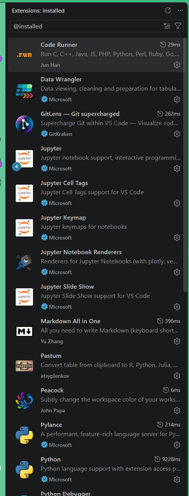

# VS Code Extensions

This document lists the curated VS Code extensions for this workspace, their command-line IDs, and a brief description of each extension.

| Extension name | Extension ID | Description |
| --- | --- | --- |
| Pastum | `atsyplenkov.pastum` | Converts copied text, HTML, or CSV tables into dataframe code for languages such as R and Python. |
| Spell Right | `ban.spellright` | Checks spelling in comments, strings, and supported document types. |
| Peacock | `johnpapa.vscode-peacock` | Customizes workspace colors to distinguish windows or projects. |
| Start Git Bash | `mccarter.start-git-bash` | Opens a Git Bash terminal from VS Code. |
| Rainbow CSV | `mechatroner.rainbow-csv` | Highlights CSV columns and provides tools for working with delimited data. |
| GitLens | `eamodio.gitlens` | Adds Git history, blame annotations, and repository insights in the editor. |
| Gemini Code Assist* | `google.geminicodeassist` | Provides AI-powered coding assistance from Google Gemini. |
| Python Debugger | `ms-python.debugpy` | Enables Python debugging with breakpoints and interactive inspection. |
| Python | `ms-python.python` | Adds Python language support, editing features, and interpreter selection. |
| Pylance | `ms-python.vscode-pylance` | Adds Python code completion, navigation, type information, and diagnostics. |
| Python Environments | `ms-python.vscode-python-envs` | Discovers and manages Python environments for projects. |
| Ruff | `charliermarsh.ruff` | Provides fast Python linting, formatting, and automatic fixes. |
| Code Runner | `formulahendry.code-runner` | Runs code files or selected snippets in supported languages, optionally in the integrated terminal. |
| Jupyter | `ms-toolsai.jupyter` | Supports editing and running Jupyter notebooks in VS Code. |
| Jupyter Keymap | `ms-toolsai.jupyter-keymap` | Adds familiar keyboard shortcuts for working with Jupyter notebooks. |
| Jupyter Notebook Renderers | `ms-toolsai.jupyter-renderers` | Renders rich notebook outputs such as plots and interactive visualizations. |
| Jupyter Cell Tags | `ms-toolsai.vscode-jupyter-cell-tags` | Adds support for tagging notebook cells. |
| Jupyter Slide Show | `ms-toolsai.vscode-jupyter-slideshow` | Helps create slideshows from tagged notebook cells. |
| Data Wrangler | `ms-toolsai.datawrangler` | Provides interactive tabular data exploration and cleaning, with Pandas code generation. |
| Quarto | `quarto.quarto` | Supports authoring, running, and previewing Quarto documents. |
| R Debugger | `rdebugger.r-debugger` | Enables debugging of R code in VS Code. |
| R | `reditorsupport.r` | Adds R language support and common development features. |
| R Syntax | `reditorsupport.r-syntax` | Provides syntax highlighting for R code. |
| Rainbow Brackets | `tal7aouy.rainbow-bracket` | Uses distinct colors to help match nested brackets and delimiters. |
| Markdown All in One | `yzhang.markdown-all-in-one` | Adds Markdown editing shortcuts, previews, and formatting tools. |

* I am not currently able to connect Gemini Code Assist to VS Code, so I am using GitHub Copilot AI.

## Prerequisites

- VS Code must be installed.
- PowerShell and the VS Code `code` command must be available.
- Run the commands from the repository root so the output file is created at the expected path.

## Create and install from `extensions.txt`

**Before running this snippet, disconnect from your VPN.** A VPN connection can interfere with certificate verification and cause extension installation to fail.

Run this PowerShell snippet to create `customization\extensions.txt` from the curated IDs above and install those extensions in VS Code:

```powershell
$extensions = @(
    'atsyplenkov.pastum'
    'ban.spellright'
    'johnpapa.vscode-peacock'
    'mccarter.start-git-bash'
    'mechatroner.rainbow-csv'
    'eamodio.gitlens'
    'ms-python.debugpy'
    'ms-python.python'
    'ms-python.vscode-pylance'
    'ms-python.vscode-python-envs'
    'charliermarsh.ruff'
    'formulahendry.code-runner'
    'ms-toolsai.jupyter-keymap'
    'ms-toolsai.jupyter-renderers'
    'ms-toolsai.vscode-jupyter-cell-tags'
    'ms-toolsai.vscode-jupyter-slideshow'
    'ms-toolsai.datawrangler'
    'quarto.quarto'
    'rdebugger.r-debugger'
    'reditorsupport.r'
    'reditorsupport.r-syntax'
    'tal7aouy.rainbow-bracket'
    'yzhang.markdown-all-in-one'
)

$extensions | Set-Content -Path .\customization\extensions.txt
Get-Content .\customization\extensions.txt | ForEach-Object { code --install-extension $_ }
```

The first command writes one extension ID per line to the text file. The second reads those IDs and asks the VS Code command-line interface to install each extension. Run the snippet again whenever you want to recreate the file and install the listed extensions.

Keep the extension IDs in the PowerShell array aligned with the table above when updating this curated list. The generated `extensions.txt` contains only these entries; it is not a snapshot of all extensions currently installed. To print the IDs installed in the current VS Code environment, run:

```powershell
code --list-extensions
```

## Confirm the extensions are installed

In VS Code, open the **Extensions** panel and type `@installed` in the **Search Extensions** box. The panel will show extensions installed in the current VS Code environment. Check that the extensions from the curated list appear there.

